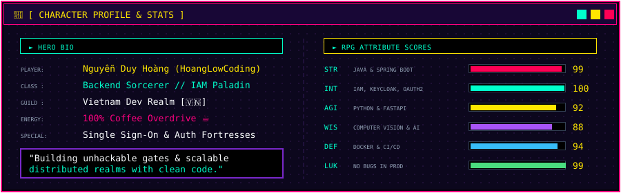

  <!-- ==================== 1. PIXEL RETRO BANNER ==================== -->
  

    

  <!-- 8-Bit Retro Buttons -->
  
  
  

    

  <!-- ==================== 2. PIXEL CHARACTER SHEET ==================== -->
  

    

  <!-- ==================== 3. PIXEL QUEST BOARD ==================== -->
  

    

  <!-- ==================== 4. PIXEL INVENTORY & SKILL TREE ==================== -->
  

    

  <!-- ==================== 5. LIVE PIXEL ARCADE BATTLE ==================== -->
  

    

  <!-- ==================== 6. RETRO ARCADE BATTLE STATS ==================== -->
  

    
    &nbsp;&nbsp;
    
  

  

    
  

   

  

    👾 <b>INSERT COIN TO CONTINUE</b> • <i>Crafted with pure pixel magic by <a href="https://github.com/HoangLowCodee">HoangLowCoding</a></i> 🎮
  

