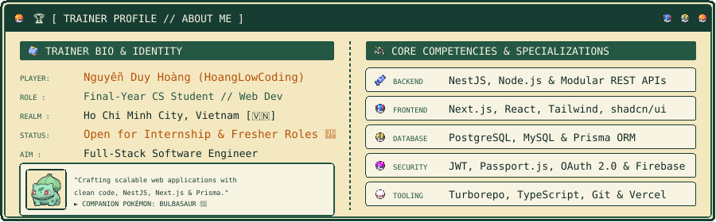
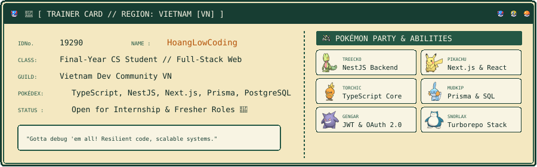
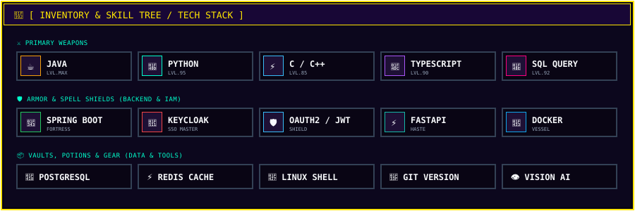
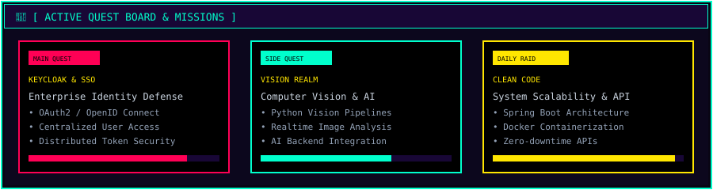
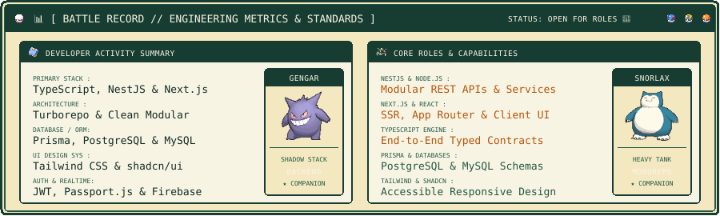
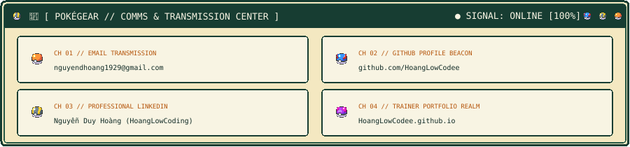

  <!-- ==================== 1. GAME HEADER — OPENING SCREEN ==================== -->
  

    

  <!-- ==================== 2. TRAINER PROFILE — ABOUT ME ==================== -->
  

    

  <!-- ==================== 3. OFFICIAL GBA TRAINER CARD ==================== -->
  

    

  <!-- ==================== 4. TRAINER INVENTORY — TECH STACK ==================== -->
  

    

  <!-- ==================== 5. QUEST LOG — ACTIVE MISSIONS ==================== -->
  

    

  <!-- ==================== 6. BATTLE RECORD — GITHUB STATS ==================== -->
  

    

  <!-- ==================== 7. POKÉGEAR — COMMS & TRANSMISSION ==================== -->
  

    

  <!-- Pokégear Direct Channel Links -->
  
  &nbsp;
  
  &nbsp;
  
  &nbsp;
  

    

  <!-- ==================== 8. END-GAME FOOTER ==================== -->
  

