  <!-- ==================== A. POKÉMON RETRO GBA BANNER ==================== -->
  

    

  <!-- Quick Action Badges -->
  
  
  

 

<!-- ==================== B. ANIMATED INTRODUCTION ==================== -->
### 🌿 Wild Developer Encounter!

  
  Xin chào! Mình là <b>Nguyễn Duy Hoàng</b> (<code>HoangLowCodee</code>) — một Full-Stack &amp; Backend Developer trẻ đang trên hành trình khám phá và chinh phục thế giới lập trình.
    
  Hiện tại, mình đang tập trung nâng cao chuyên môn về <b>Microservices Architecture</b> và xây dựng các giải pháp <b>Hệ thống Quản lý Định danh &amp; Xác thực (IAM / Single Sign-On)</b>. Mình đam mê tạo ra các sản phẩm phần mềm sạch, bảo mật cao và vận hành ổn định.
    
  <i>Mục tiêu phát triển:</i> Không ngừng thu thập "Huy hiệu Kỹ năng", tối ưu hóa từng dòng code và phát triển các sản phẩm công nghệ hữu ích mỗi ngày.

 

---

<!-- ==================== C. ABOUT ME — TRAINER PROFILE ==================== -->
## 🎮 About Me

  

 

* 🔭 **Currently working on:** `[CURRENT PROJECT]` — Hệ thống phân tán và các kiến trúc ứng dụng web hiệu năng cao.
* 🌱 **Currently learning:** Spring Cloud, Distributed Tracing, Next.js App Router và Clean Architecture.
* 💻 **Interested in:** Full-stack development, backend engineering và software architecture.
* 🎯 **Goal:** Building useful software and improving every day.
* 📍 **Location:** Vietnam 🇻🇳

 

---

<!-- ==================== D. TECH STACK — INVENTORY ==================== -->
## 🧰 Tech Stack

> *“Một Trainer giỏi luôn biết cách trang bị kỹ năng phù hợp cho từng thử thách.”*

### 🗡️ Languages

  

### ⚙️ Backend

  

### 🎨 Frontend

  

### 🗄️ Database

  

### 🛠️ Tools

  

 

---

<!-- ==================== E. PROJECTS — QUEST LOG ==================== -->
## 🗺️ Quest Log

Dưới đây là một số chiến dịch tiêu biểu đang được hoàn thiện:

| 🏆 Quest / Project | 📜 Description | ⚡ Tech Stack | 🔗 Links |
| :--- | :--- | :--- | :--- |
| **🛡️ IAM Fortress (Keycloak SSO)** | Cổng xác thực tập trung &amp; phân quyền người dùng chuẩn OAuth2/OIDC cho microservices. | `Java` `Spring Boot` `Keycloak` `Docker` | [Repository](https://github.com/HoangLowCodee) • [Demo](https://github.com/HoangLowCodee) |
| **🌐 Enterprise Portal &amp; Gateway** | Cổng giao tiếp phân tán, định tuyến tải và quản lý rate limit cho hệ sinh thái backend. | `Spring Cloud` `Redis` `PostgreSQL` | [Repository](https://github.com/HoangLowCodee) • [Demo](https://github.com/HoangLowCodee) |
| **⚡ Full-Stack Dashboard Hub** | Ứng dụng quản trị và giám sát trạng thái hệ thống theo thời gian thực với giao diện trực quan. | `React` `TypeScript` `Tailwind` `Node.js` | [Repository](https://github.com/HoangLowCodee) • [Demo](https://github.com/HoangLowCodee) |
| **🤖 Vision AI Pipeline** | Module xử lý thị giác máy tính và phân loại dữ liệu hình ảnh tự động. | `Python` `PyTorch` `FastAPI` | [Repository](https://github.com/HoangLowCodee) • [Demo](https://github.com/HoangLowCodee) |

 

---

<!-- ==================== F. GITHUB STATS ==================== -->
## 📊 GitHub Stats

  <table border="0">
    <tr>
      <td>
        
      </td>
      <td>
        
      </td>
    </tr>
  </table>

  

 

---

<!-- ==================== G. CONTACT — COMMUNICATION CENTER ==================== -->
## 📡 Let's Connect

Bạn có ý tưởng dự án thú vị hoặc muốn cùng trao đổi về công nghệ? Hãy gửi tín hiệu đến Pokégear của mình:

  
  &nbsp;
  
  &nbsp;
  
  &nbsp;
  

  

<!-- ==================== H. FOOTER ==================== -->

  

  

    <i>Thanks for visiting my profile. See you on the next quest!</i>
  

  👾 <b>GOTTA CODE 'EM ALL</b> • Crafted with Pokémon Pixel Art &amp; Markdown Magic by <a href="https://github.com/HoangLowCodee">HoangLowCoding</a> 🌿

